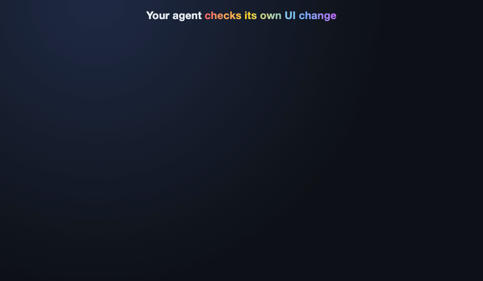
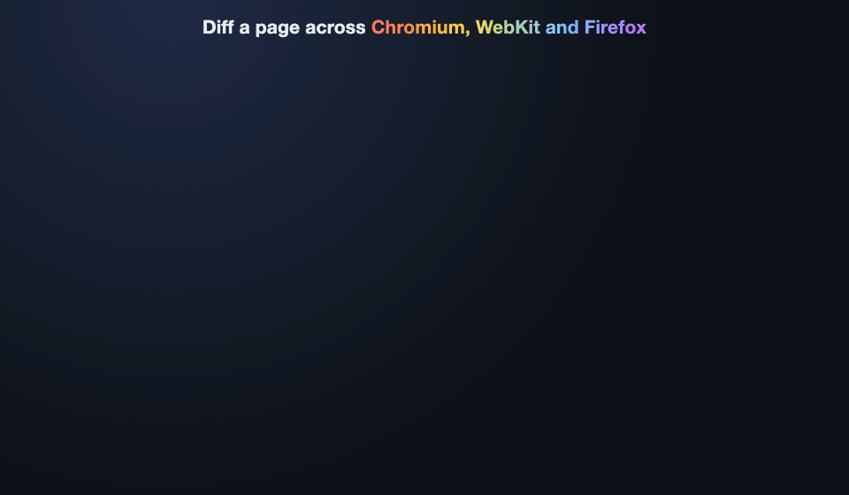

# Chromascope


 

**Let your coding agent see what its UI change did.**

Coding agents edit CSS and components without looking at the result, then call the change done. Chromascope gives them a way to check: capture the page in real browsers before the change, capture it again after, and get back a pixel change percentage plus diff images that show what moved. The agent opens the images and can tell you, region by region, that every change is one it meant to make.

It works the same for you in a terminal or a CI job. Chromascope uses Playwright to capture Chromium, WebKit and Firefox, and pixelmatch to compare them.



## Quick start with a coding agent

Install the agent skill with the [`skills`](https://github.com/vercel-labs/skills) CLI. It asks which agents to install it for, like Claude Code, Codex or Cursor:

```bash
npx skills add Shtian/chromascope
```

Then ask for a UI change the way you normally would:

> Tighten the padding on the pricing cards at localhost:3000/pricing. Use chromascope to check that nothing else on the page moved.

The skill tells the agent when to reach for chromascope, which commands to run, how to read the JSON and exit codes, and to open the diff images before it calls the change done. It runs `chromascope`, falling back to `npx chromascope`, so nothing else needs installing. The first run may ask the agent to run `chromascope install` to download the browsers.

You can also copy [`skills/chromascope`](skills/chromascope/SKILL.md) into your agent's skills folder, like `.claude/skills/` in a project or `~/.claude/skills/` for every project with Claude Code.

## Flows

### Make a UI change, and only that change

The agent captures a baseline before it touches the code, makes the change, compares, and looks at the diff. When something it didn't mean to change shows up, it fixes the code and compares again. The baseline stays put, so it can repeat this as often as needed.

```bash
chromascope snapshot localhost:3000/pricing --element .card
# ...edit the code...
chromascope compare localhost:3000/pricing --element .card --json --out /tmp/pricing
```

`compare` writes `before-chromium.png`, `after-chromium.png` and `diff-chromium.png`. Changed pixels are red in the diff, so a padding change that also shifted the footer is obvious at a glance. Finish with `--clean` to delete the baseline, or `--update` to keep the new look as the next "before".

### Prove a refactor changed nothing

Migrating to Tailwind, upgrading a component library or deleting dead CSS should leave the page exactly as it was. Take a full-page baseline, refactor, and fail on any changed pixel:

```bash
chromascope snapshot localhost:3000 --full-page --browsers chromium,firefox,webkit
# ...refactor...
chromascope compare localhost:3000 --fail-above 0
```

Exit `0` means no pixel moved in any browser. Exit `1` means something did, and the diff images show where. This gives the agent a hard pass or fail instead of "looks right to me".

### Match production

When the "before" is already deployed, like during a rewrite, a framework migration or a port to a new design system, compare the live page with the local build directly. No baseline needed:

```bash
chromascope versus https://example.com/pricing localhost:3000/pricing --json --out /tmp/parity
```

Each browser's capture of the local page is measured against its own capture of production. `--cookie` sets the same cookies for both URLs, for pages behind a login.

### Check other browsers before opening a PR



```bash
chromascope diff localhost:3000/pricing --json --out /tmp/xb --fail-above 1
```

`diff` captures the page in Chromium, WebKit and Firefox and compares each with Chromium. Some difference between engines is normal. Scattered specks along text edges are font rendering, and a solid block of red is a layout bug. The skill teaches the agent to tell them apart.

### Gate CI on visual drift

`--fail-above <percent>` makes any comparison exit `1` above the threshold, and output is plain text when `CI` is set, so the same commands work as a CI step.

## Built to be called by agents

- **No prompts, ever.** Chromascope runs to completion without a human watching.
- **One JSON document.** `--json` prints exactly one versioned document on stdout, or an error object with a stable `code`, a `message` and a `hint` that names the fix. TypeScript types ship with the package.
- **Exit codes that mean something.** `0` within the threshold, `1` above `--fail-above`, `2` usage error, `3` runtime error.
- **Predictable files.** `--out <dir>` writes the images to exactly that folder, and every printed path is absolute.
- **Stable captures.** Every capture waits for web fonts and disables animations, transitions and the text caret. `--mask <selector>` hides timestamps, ads and other content that changes on every load.
- **Self-explaining.** Every command's `--help` lists its flags, exit codes, error codes and examples, and `chromascope doctor` names each broken setup check and how to fix it.
- **Local by default.** `localhost` URLs get `http://`, and baselines live in `.chromascope/`, which chromascope gitignores for you.

## What it isn't

Chromascope isn't a visual regression suite like Percy, Chromatic or Playwright's `toHaveScreenshot`. Those keep committed golden images and review them in CI. Chromascope's baselines are short-lived and belong to one working session: capture, change, check, throw the baseline away. It's for the moment while you or your agent are making a change, not for guarding a page forever. You can still use `diff` and `versus` with `--fail-above` as a CI gate.

## Install

Run it with npx, or install it globally with pnpm, npm or yarn:

```bash
npx chromascope <command> [options]
pnpm add -g chromascope
npm i -g chromascope
yarn global add chromascope
```

Chromascope needs Node 24 or later and the Chromium, Firefox and WebKit browsers from Playwright. Install the browsers once, then check that everything is ready:

```bash
chromascope install
chromascope doctor
```

## Commands

| Command | What it does |
| --- | --- |
| `snapshot <url>` | Capture a baseline of the URL for a later `compare` |
| `compare [url]` | Capture the URL again and compare each browser against its baseline |
| `versus <before-url> <after-url>` | Compare the second URL against the first in each browser (alias `vs`) |
| `diff <url>` | Capture the URL in several browsers and compare each against the base browser |
| `clean [name]` | Delete the baseline with this name, or every baseline |
| `doctor` | Check that Node, the browsers and the output folder are ready |
| `install` | Install the browsers chromascope uses |

Every flag, output format, JSON field, exit code and error code is in the [reference](docs/reference.md).

## Contributing

See [CONTRIBUTING.md](CONTRIBUTING.md).
